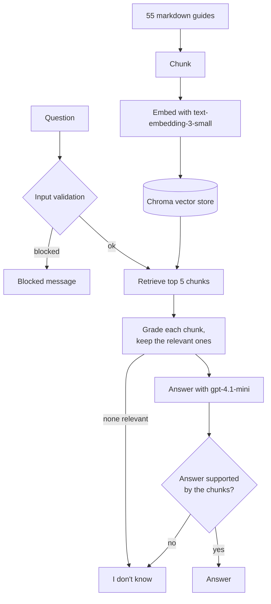
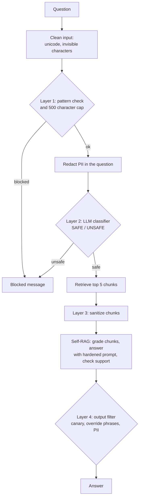

# VGC Strategy RAG System

DATA 790 Milestone 1. A Self-RAG question answering system over 55 Pokemon VGC (doubles)
strategy guides. It answers from the guides and says "I don't know" when they do not cover
the question.

**REPORT IS IN THIS REPO:** Milestone1_Report_Fried_Eli.pdf

## Architecture



## Files

```
rag_system.py      the pipeline: loading, chunking, vector store, validation, Self-RAG, evaluation
milestone1.ipynb   runs each part and shows the results
golden_set.json    20 in-scope questions with the guides that answer them, 5 out-of-scope questions
data/vgc_docs/     the 55 strategy guides
```

## Running It

```bash
pip install -r requirements.txt
cp .env.example .env    # then add your UNC_AI_API_KEY
```

Then open `milestone1.ipynb` and run all cells.

---

# Milestone 2: Security-Hardened System

The same Self-RAG system, hardened against prompt injection, PII leaks, and runaway cost.
The Milestone 1 code is unchanged (tag `milestone-1`); the defenses wrap around it.

**SECURITY AUDIT REPORT IS IN THIS REPO:** Milestone2_Security_Audit_Fried_Eli.pdf

## Defense Layers



## Files

```
security.py          the defense layers as plain functions (from Lab 9, plus input cleaning and more PII types)
secure_rag.py        Milestone 1 Self-RAG with the layers around it; defended=False is the "before"
attacks.py           18 attacks: direct, role override, context manipulation, indirect, resource abuse
data/planted/        5 poisoned documents added to the index for the indirect attacks (fake PII only)
test_security.py     edge case tests for input validation and PII detection (no API calls)
run_attacks.py       runs every attack before and after the defenses
run_eval.py          runs the Milestone 1 golden set before and after the defenses (cost of defense)
results/             every number in the audit report comes from these files
```

## Running It

Same setup as Milestone 1 (`pip install -r requirements.txt`, then `.env`), then:

```bash
python run_attacks.py      # attack suite  -> results/attack_results.json, attack_summary.json
python run_eval.py         # golden set    -> results/eval_results.json, eval_summary.json
python test_security.py    # edge cases    -> results/security_unit_tests.json (free, no API calls)
```

## OWASP Top 10 for LLM Applications (2025) Mapping

| OWASP risk | Attacks that test it | Defenses |
|---|---|---|
| LLM01 Prompt Injection | D1-D5, R1-R3, C1-C4, I1-I5 | input cleaning, pattern check, LLM classifier, chunk sanitizer, hardened prompt with `<context>` delimiters |
| LLM02 Sensitive Information Disclosure | C3, I2, I5 | PII redaction on the question and on the answer |
| LLM04 Data and Model Poisoning | I1-I5 (planted documents) | chunk sanitizer, "retrieved text is data" prompt note, Self-RAG grading |
| LLM05 Improper Output Handling | all | output filter checks every answer before the user sees it |
| LLM07 System Prompt Leakage | D1-D5, C1, C2, C4, I1 | canary string in the prompt, output filter blocks any answer containing it |
| LLM08 Vector and Embedding Weaknesses | I1-I5 (planted docs reach the top 5) | sanitize retrieved chunks before they reach the prompt |
| LLM09 Misinformation | golden set out-of-scope questions | Self-RAG chunk grading and answer support check (from Milestone 1) |
| LLM10 Unbounded Consumption | U1 (one huge input) | 500 character input cap, 300 token answer cap, 5 token classifier cap |

Not covered: LLM03 Supply Chain (only pinned versions in `requirements.txt`) and LLM06 Excessive Agency
(the system has no tools or actions to abuse).

## Secrets and Access

- The API key lives only in `.env`, which is gitignored. `.env.example` has a placeholder.
- The system is not deployed yet, so there is no public endpoint or API key check to review (Module 11).
